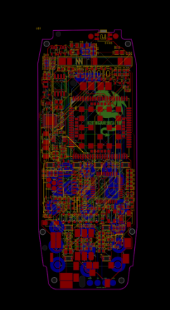
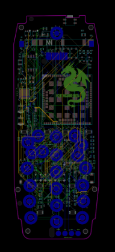
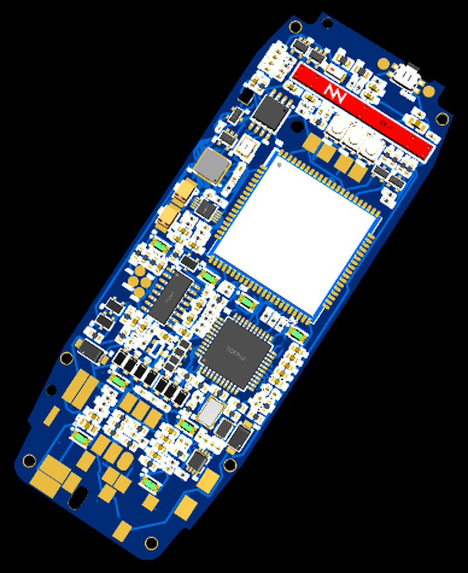
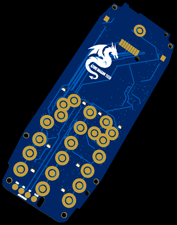
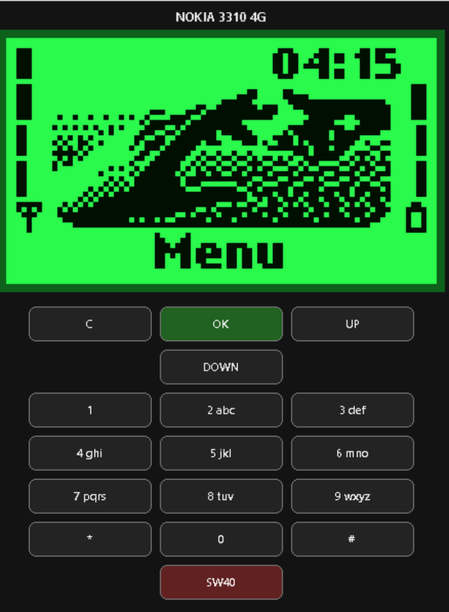
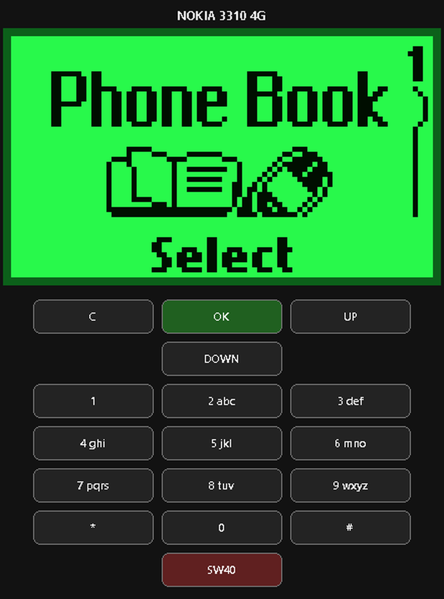
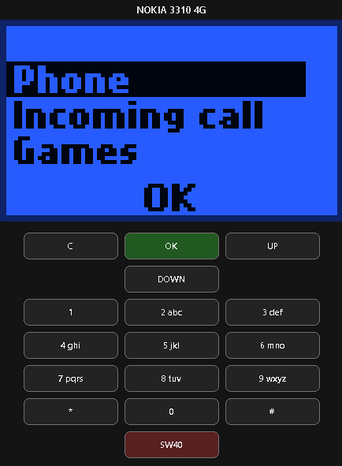
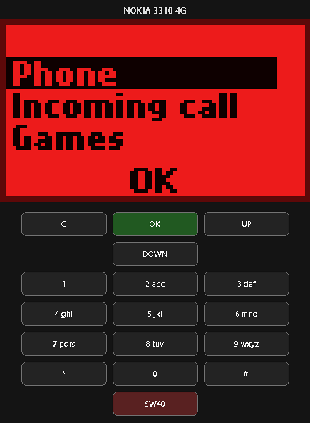

# English version

# RetroShell — Nokia 3310 4G Replacement Board

Support the development of RetroShell by Azure Dragon Tech.

## What is RetroShell?

**RetroShell is an experimental replacement-board project for the original Nokia 3310 electronics.** The goal is to retain the stock enclosure, keypad, and familiar classic-phone experience while introducing modern hardware capabilities and custom firmware.

The project is part of **Azure Dragon Tech**. In the longer term, the concept may evolve into a modular electronics platform for other devices. The phone version and future specialised applications will be developed as separate use cases.

> **Current status: design / pre-prototype.** The board has not yet been manufactured or subjected to initial hardware testing. The features listed here are development goals, not verified capabilities of a finished device.

## Board concept

- The first target model is the **Nokia 3310**.
- The design aims to fit the original enclosure without permanent case modifications.
- In phone configuration, no external peripheral connectors are planned; the device should remain as close as possible to the stock phone in appearance and everyday use.
- Mechanical fit and compatibility with the display, keypad, power system, and other components must be checked on a prototype.

### Planned features

- **4G LTE:** cellular connectivity using a suitable modem, antenna, and compatible network configuration.
- **Bluetooth headset:** Bluetooth is intended for phone calls through a compatible headset; it is not presented as a universal peripheral interface.
- **Controllable colour backlight:** colour selection and event-based colour changes, such as for incoming calls, SMS messages, game events, and other notifications, subject to hardware implementation.
- **Custom firmware:** independently written code intended to reproduce the original Nokia 3310 interface and behaviour as closely as practical. The project does not rely on modifying Nokia's original firmware code.
- **System sounds:** a custom sound system instead of the original system sounds.
- **Snake and Tamagotchi:** integration of Snake and a virtual-pet game. Tamagotchi is intended to run in the background and update its state while the user uses other phone features.

Each feature will be considered confirmed only after implementation and testing.

## Concept images

### PCB layout

| PCB layout — side A | PCB layout — side B |
|---|---|
|  |  |

### 3D PCB renders

| Front side | Back side |
|---|---|
|  |  |

### Firmware interface concept

The following images illustrate the proposed interface concept. They do not demonstrate firmware running on a physical prototype.

| Home screen | Phonebook |
|---|---|
|  |  |

| Incoming call — blue theme | Incoming call — red theme |
|---|---|
|  |  |

## Transformer concept and future applications

Outside the original phone enclosure, the platform could become the basis for specialised devices. Such applications may require different enclosures, external connectors, additional modules, and separate hardware variants.

Potential areas of exploration include:

- robotics and drone-related electronics;
- wireless diagnostics and research tools;
- GSM/LTE devices, gateways, and experimental communications systems;
- sensors, microcontrollers, and other peripheral hardware.

These are long-term concepts. Interfaces, electrical limits, safety requirements, and applicable regulations must be assessed separately. Cellular operation depends on the modem, antennas, supported bands, carrier requirements, and local regulations.

## Other phone models

Future models are separate projects and are **not intended to be compatible with the Nokia 3310 board**:

- **Nokia 3410:** a separate board and firmware; use of the 3410 enclosure is being considered and requires validation.
- **Nokia 3210, Nokia 3510, and Nokia 3510i:** separate hardware projects with their own boards and software.

Each model requires its own assessment of mechanical geometry, display, keypad, power, and hardware interfaces.

## Roadmap

- [x] Initial concept and preliminary visualisations.
- [ ] Review circuitry and component choices.
- [ ] Manufacture the first prototype.
- [ ] Check fit in the Nokia 3310 enclosure.
- [ ] Test display, keypad, power, and backlight.
- [ ] Develop and test firmware.
- [ ] Validate Bluetooth headset and cellular connectivity.
- [ ] Document test results and limitations.

## Contributions and support

The project is at an early stage. Discussion, constructive suggestions, and help reviewing the architecture are welcome. Manufacturing partnerships and support can be considered once the technical scope has been agreed.

Schematics, native PCB design files, Gerber files, and the bill of materials are not being published at this stage.

## Disclaimer

RetroShell is an independent experimental project by Azure Dragon Tech. It is not affiliated with or endorsed by Nokia. Nokia and phone model names are used to identify target devices and intended compatibility. All features remain planned until verified through testing.
